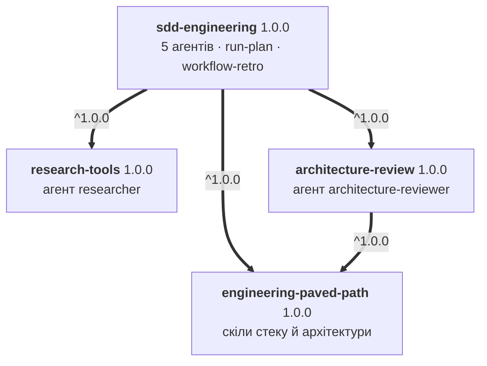
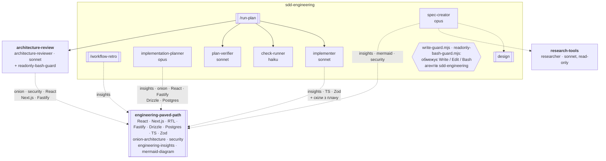
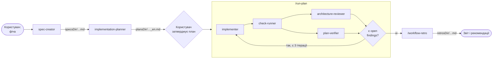

# Специфікація: плагіни SDD Engineering і їхні залежності

Статус: реалізовано на гілці `feat/sdd-plugins` (не закомічено) · Дата: 2026-10-20 · Джерело: [MShcherbyna/dev-digest](https://github.com/MShcherbyna/dev-digest) (`.claude/agents`, `.claude/skills`, `.claude/hooks`, `scripts/review-bundle.sh`)

## 1. Мета

Перенести з DevDigest робочий процес Spec Driven Development у маркетплейс так, щоб його можна було встановити в будь-який проєкт однією командою:

```
/plugin install sdd-engineering@dev-digest-toolkit
```

Процес — `spec → plan → implement → review → verify` плюс ретроспектива прогону. Агенти, які корисні й поза цим процесом (дослідник, архітектурний рев'юер), і знання про стек виносимо в окремі плагіни, щоб їх можна було перевикористовувати.

### Обсяг

| Плагін | Роль | Склад |
|---|---|---|
| `engineering-paved-path` | залежність | скіли: React, Next.js, Fastify, архітектура, тестування, безпека й суміжні ([§4](#4-де-живуть-спільні-скіли)) |
| `research-tools` | залежність | агент `researcher` (read-only) |
| `architecture-review` | залежність | агент `architecture-reviewer` (узагальнений) |
| `sdd-engineering` | основний | агенти `spec-creator`, `implementation-planner`, `implementer`, `plan-verifier` і допоміжний `check-runner`; скіли `run-plan`, `workflow-retro`; evals; README з описом процесу; CHANGELOG |

### Не переносимо

- Продуктові специфікації та плани DevDigest (`specs/`, `docs/plans/`, `.claude/sdd-runs/`).
- Секрети, `settings.local.json`, кеші, `.claude/pr-self-review/last-report.json`.
- Інструкції, специфічні для DevDigest: пакети `client/ server/ reviewer-core/ mcp/ e2e/`, команди `pnpm`, таблиці модулів.
- Агенти `test-writer`, `doc-writer`, `plan-translator` і скіли `pr-self-review`, `dependency-checker`: вони поза ланцюжком `run-plan` або прив'язані до скриптів DevDigest. Їх можна додати пізніше окремими плагінами.

## 2. Граф залежностей

### 2.1 Залежності між плагінами

Що оголошено в `plugin.json` і що встановлюється автоматично.



### 2.2 Компоненти і хто кого використовує

Суцільна стрілка — `run-plan` запускає агента. Пунктир — агент передзавантажує або викликає скіл чи іншого агента; підпис — які саме скіли. Подвійна рамка — скіл або набір скілів, шестикутник — guard-хук.



### 2.3 Процес, який з цього складається



### 2.4 Правила графа

- `sdd-engineering` залежить від усіх трьох у діапазоні `^1.0.0`. Залежності встановлюються автоматично під час `claude plugin install`.
- `architecture-review` залежить від `engineering-paved-path` у діапазоні `^1.0.0`: `architecture-reviewer` перевіряє код за його скілами (onion-architecture, security, React, Next.js, Fastify). Тому `engineering-paved-path` встановлюється разом з ним, навіть коли `architecture-review` ставлять окремо від `sdd-engineering`.
- `research-tools` і `engineering-paved-path` ні від чого не залежать.
- `sdd-engineering` оголошує `engineering-paved-path` і напряму, хоча той приходить і транзитивно через `architecture-review`. Агенти `sdd-engineering` самі викликають його скіли, тож залежність має бути явною. Обидва діапазони однакові (`^1.0.0`), тому конфлікту версій немає.
- Циклів немає. Листки графа — `engineering-paved-path` і `research-tools`.

`plugins/sdd-engineering/.claude-plugin/plugin.json`:

```json
{
  "name": "sdd-engineering",
  "version": "1.0.0",
  "dependencies": [
    { "name": "engineering-paved-path", "version": "^1.0.0" },
    { "name": "research-tools", "version": "^1.0.0" },
    { "name": "architecture-review", "version": "^1.0.0" }
  ]
}
```

Діапазони резолвляться за git-тегами `<plugin>--v<version>` ([RELEASES.md](../RELEASES.md#2-tag-on-main-after-the-merge)), тому порядок тегування такий: `engineering-paved-path` і `research-tools` → `architecture-review` → `sdd-engineering`. Інакше встановлення верхнього плагіна з GitHub-маркетплейсу впаде.

`plugins/architecture-review/.claude-plugin/plugin.json`:

```json
{
  "name": "architecture-review",
  "version": "1.0.0",
  "dependencies": [{ "name": "engineering-paved-path", "version": "^1.0.0" }]
}
```

## 3. Плагіни

Усі чотири стартують з `1.0.0`: процес уже відпрацьований у DevDigest, а `^1.0.0` не матчить `0.x`.

### 3.1 `engineering-paved-path`

Лише скіли, без агентів і хуків. Викликаються через простір імен: `engineering-paved-path:react-best-practices`.

| Скіл | Джерело в DevDigest | Що змінюємо |
|---|---|---|
| `react-best-practices` | `.claude/skills/react-best-practices` | — |
| `react-frontend-architecture` | `…/react-frontend-architecture` | прибрати шляхи `client/src/...` з прикладів |
| `react-testing-library` | `…/react-testing-library` | 603 рядки → розбити, тіло SKILL.md ≤ 500 |
| `next-best-practices` | `…/next-best-practices` | — |
| `fastify-best-practices` | `…/fastify-best-practices` (+ `rules/`) | видалити `tile.json` |
| `onion-architecture` | `…/onion-architecture` (+ `scripts/module-imports.sh`) | скрипт через `${CLAUDE_SKILL_DIR}`, шлях до модулів — аргументом |
| `typescript-expert` | `…/typescript-expert` | — |
| `zod` | `…/zod` (+ `references/`) | — |
| `drizzle-orm-patterns` | `…/drizzle-orm-patterns` | — |
| `postgresql-table-design` | `…/postgresql-table-design` | — |
| `security` | `…/security` | — |
| `mermaid-diagram` | `…/mermaid-diagram` | — |
| `engineering-insights` | `…/engineering-insights` | таблицю модулів DevDigest замінити на `modules[]` з конфігу ([§5.1](#51-шляхи-проєкту--явні-inputs)) |

#### Ліцензії

Скіли взято з [ai-agentic-engineering-neo/dev-digest](https://github.com/ai-agentic-engineering-neo/dev-digest) (MIT, © 2026 Ivan Lapa). Сторонні скіли там зафіксовано в `skills-lock.json`. Перевірено 2026-10-20:

| Скіл | Першоджерело | Ліцензія | Що робимо |
|---|---|---|---|
| `fastify-best-practices` | [mcollina/skills](https://github.com/mcollina/skills) `skills/fastify` | MIT | включаємо + notice |
| `drizzle-orm-patterns` | [giuseppe-trisciuoglio/developer-kit](https://github.com/giuseppe-trisciuoglio/developer-kit) | MIT | включаємо + notice |
| `postgresql-table-design` | [wshobson/agents](https://github.com/wshobson/agents) `plugins/database-design/skills/postgresql` | MIT | включаємо + notice |
| `zod` | [pproenca/dot-skills](https://github.com/pproenca/dot-skills) `skills/.curated/zod` | MIT | включаємо + notice |
| `typescript-expert` | [sickn33/antigravity-awesome-skills](https://github.com/sickn33/antigravity-awesome-skills) | MIT (код) + CC BY 4.0 (текст, `LICENSE-CONTENT`) | включаємо + атрибуція CC BY: автор, посилання, ліцензія, позначка «змінено» |
| `next-best-practices` | [vercel-labs/next-skills](https://github.com/vercel-labs/next-skills) | **немає LICENSE** ні в джерелі, ні в upstream чи локальному dev-digest; репозиторій позначено як moved, скіл Vercel більше не підтримує | включаємо як є, з атрибуцією Vercel і позначкою «ліцензію не вказано»; ризик прийнято ([§9](#9-рішення-ризики-і-відкриті-питання)) |
| `react-best-practices`, `react-testing-library`, `security`, `mermaid-diagram` | upstream dev-digest (немає в `skills-lock.json`) | MIT, © Ivan Lapa | включаємо + notice |
| `onion-architecture`, `react-frontend-architecture`, `engineering-insights`, `design`, усі агенти, `run-plan`, `workflow-retro` | форк MShcherbyna/dev-digest | MIT, © Maksym Shcherbyna | включаємо |

- У кожному плагіні, що містить чужий текст, лежить `THIRD_PARTY_NOTICES.md`. У ньому для кожного скіла: репозиторій-джерело, коміт, з якого взято файл, повний текст ліцензії з copyright, перелік змін. MIT вимагає зберігати copyright notice в копіях, CC BY — атрибуцію і позначку про зміни.
- У frontmatter стороннього скіла додаємо `metadata.source: <owner/repo>@<sha>`, щоб походження було видно з самого файлу.
- `fastify-best-practices/tile.json` (метадані реєстру tessl) видаляємо, а його `name`/`version` переносимо в notice.

### 3.2 `research-tools`

| Компонент | Джерело | Зміни |
|---|---|---|
| агент `researcher` | `.claude/agents/researcher.md` | `tools: Read, Grep, Glob, WebSearch, WebFetch`. Зараз агенту заборонено лише Write/Edit, але Bash дозволено, тож read-only він тільки на словах. Без Bash він справді read-only, і хук не потрібен. Заборона `/deep-research` лишається |

### 3.3 `architecture-review`

| Компонент | Джерело | Зміни |
|---|---|---|
| агент `architecture-reviewer` | `.claude/agents/architecture-reviewer.md` | узагальнити ([нижче](#узагальнення-architecture-reviewer)) |
| `hooks/hooks.json` + `scripts/readonly-bash-guard.mjs` | `.claude/hooks/readonly-bash-guard.sh` (режим `git`) | вмикається лише для `agent_type = architecture-review:architecture-reviewer` ([§5.2](#52-guard-хуки)) |

#### Узагальнення architecture-reviewer

Правила DevDigest (onion `routes → service → repository`, ізоляція модулів, `'use client'`, чистота `reviewer-core`) не зашиваємо в агента. Агент працює з явних inputs:

1. **Вхід у промпті:** список змінених файлів або шлях до review-bundle, необов'язково — шлях до документа з архітектурними правилами.
2. **Правила проєкту:** документ із промпту, а якщо його немає — розділ «Architecture» з `CLAUDE.md` / `AGENTS.md` проєкту.
3. **Скіли:** за типом змінених файлів викликає через `Skill` `engineering-paved-path:onion-architecture`, `…:security`, `…:react-frontend-architecture`, `…:next-best-practices`, `…:fastify-best-practices`. Плагін — оголошена залежність (`^1.0.0`), тож скіли завжди доступні.

Формат звіту без змін: знахідки з `file:line` і цитатою коду, severity, список «cannot verify».

### 3.4 `sdd-engineering`

```
plugins/sdd-engineering/
├── .claude-plugin/plugin.json
├── agents/
│   ├── spec-creator.md
│   ├── implementation-planner.md
│   ├── implementer.md
│   ├── plan-verifier.md
│   └── check-runner.md            # допоміжний, потрібен run-plan
├── skills/
│   ├── run-plan/
│   │   ├── SKILL.md
│   │   └── scripts/review-bundle.mjs
│   ├── workflow-retro/
│   │   ├── SKILL.md
│   │   └── scripts/session_stats.py
│   └── design/SKILL.md            # потрібен лише spec-creator
├── hooks/hooks.json
├── scripts/
│   ├── write-guard.mjs            # spec-creator, implementation-planner, implementer
│   └── readonly-bash-guard.mjs    # plan-verifier, check-runner (копія з architecture-review)
├── evals/                         # claude plugin eval, §7
├── templates/sdd-engineering.json # приклад конфігу проєкту
├── CHANGELOG.md
└── README.md
```

| Компонент | Модель / effort | Що робить | Скіли (namespaced) |
|---|---|---|---|
| `spec-creator` | opus / high | пише специфікацію (EARS AC, edge cases, NFR, open questions) у `specsDir`; може запускати `research-tools:researcher` | `engineering-paved-path:engineering-insights`, `…:mermaid-diagram`, `…:security`, `sdd-engineering:design` |
| `implementation-planner` | opus / high | рев'ю вимог → питання → план у `plansDir/<feature>_en.md` | `…:engineering-insights`, `…:onion-architecture`, `…:react-frontend-architecture`, `…:fastify-best-practices`, `…:drizzle-orm-patterns`, `…:postgresql-table-design` |
| `implementer` | sonnet / medium | виконує затверджений план, typecheck і точкові тести, записує INSIGHTS | `…:engineering-insights`, `…:typescript-expert`, `…:zod` + скіли з розділу 5 плану |
| `plan-verifier` | sonnet / medium | звіряє код з кожним пунктом плану й специфікації: PASS / FAIL / PARTIAL / NOT VERIFIABLE / BLOCKED | — |
| `check-runner` | haiku / low | один раз запускає `checks` змінених модулів, повертає таблицю pass/fail | — |
| скіл `run-plan` | — | `/sdd-engineering:run-plan <plan> [mode:…] [max-fix:N]`: implementer → check-runner → `architecture-review:architecture-reviewer` ∥ plan-verifier → fix loop (≤ 3) | — |
| скіл `workflow-retro` | — | `/sdd-engineering:workflow-retro [session-id]`: статистика зі скрипта + аналіз транскриптів → звіт у `retrosDir` | — |

Обидва скіли лишаються `disable-model-invocation: true`: їх запускають лише вручну.

## 4. Де живуть спільні скіли

Правило: скіл кладемо в найнижчий плагін графа, з якого його можуть використати **всі** споживачі. Дублікатів між плагінами не робимо.

| Скіл | Плагін | Хто використовує |
|---|---|---|
| стек: React, Next.js, Fastify, Drizzle, Postgres, TS, Zod, RTL | `engineering-paved-path` | planner, implementer, architecture-reviewer, люди напряму |
| `onion-architecture`, `security` | `engineering-paved-path` | planner, spec-creator, architecture-reviewer |
| `engineering-insights`, `mermaid-diagram` | `engineering-paved-path` | spec-creator, planner, implementer, workflow-retro. Не прив'язані до SDD, корисні будь-якому агенту |
| `design` | `sdd-engineering` | лише spec-creator |
| `run-plan`, `workflow-retro` | `sdd-engineering` | оркестрація процесу |

Окремого плагіна `shared-skills` не створюємо: `engineering-insights` і `mermaid-diagram` уже лежать у залежності, яку ставить `sdd-engineering`. Окремий плагін додав би ще одну залежність без жодного нового споживача.

Єдиний свідомий дублікат — скрипт `readonly-bash-guard`: він є і в `architecture-review` (режим `git`), і в `sdd-engineering` (режим `verify` для plan-verifier і check-runner). Плагіни самодостатні, посилання за межі каталогу плагіна не копіюються ([PLUGIN-GUIDELINES §1](../PLUGIN-GUIDELINES.md#1-layout)), тому копія неминуча. Синхронність копій перевіряє `validate-marketplace.mjs` (копії з позначкою «shared verbatim» мають бути ідентичні).

## 5. Адаптація з DevDigest

### 5.1 Шляхи проєкту → явні inputs

Усі шляхи DevDigest стають inputs з дефолтами. Джерело правди — необов'язковий файл у проєкті `.claude/sdd-engineering.json`. Його читають агенти (через `Read`), скіли і guard-хуки:

```json
{
  "specsDir": "specs",
  "plansDir": "docs/plans",
  "runsDir": ".claude/sdd-runs",
  "retrosDir": "docs/retros",
  "designDir": "design",
  "architectureDoc": null,
  "modules": [
    {
      "path": "server",
      "insights": "server/INSIGHTS.md",
      "specsDir": "server/specs",
      "checks": ["pnpm -C server typecheck", "pnpm -C server test"]
    }
  ],
  "protectedPaths": ["**/package-lock.json", "**/pnpm-lock.yaml", "**/migrations/**"],
  "forbiddenCommands": ["db:migrate"],
  "reviewBundleExcludes": ["docs/plans", "**/pnpm-lock.yaml"]
}
```

- Немає файлу — діють дефолти, `modules` = один модуль у корені репозиторію без `checks`. У такому разі `check-runner` повертає `not configured`, а не вгадує команди.
- `userConfig` плагіна для цього не підходить: він зберігається на рівні користувача (`pluginConfigs` у `~/.claude/settings.json`), а шляхи різні для кожного проєкту.
- Агенти отримують конкретні шляхи в промпті від `run-plan` або від користувача. Конфіг — лише дефолт.
- `run-plan`, `implementation-planner` і `implementer` замість `client/ server/ reviewer-core` працюють з `modules[]`.

| DevDigest | Плагін |
|---|---|
| `specs/`, `<pkg>/specs/` | `specsDir`, `modules[].specsDir` |
| `docs/plans/<feature>_en.md` | `plansDir` |
| `.claude/sdd-runs/<feature>.md` | `runsDir` (порадити додати в `.gitignore`) |
| `docs/retros/` | `retrosDir` |
| `client/INSIGHTS.md` … | `modules[].insights` |
| `npx --yes pnpm@10 -C <pkg> …` в check-runner і guard | `modules[].checks` |
| `scripts/review-bundle.sh` | `node "${CLAUDE_SKILL_DIR}/scripts/review-bundle.mjs"` (порт на node, виключення з `reviewBundleExcludes`) |
| `.claude/skills/workflow-retro/scripts/session_stats.py` | `${CLAUDE_SKILL_DIR}/scripts/session_stats.py` |
| `.claude/agents/README.md` (посилання з run-plan) | `README.md` плагіна |
| `zod`, `onion-architecture` … у `skills:` | `engineering-paved-path:zod` … |
| `researcher`, `architecture-reviewer` у промптах | `research-tools:researcher`, `architecture-review:architecture-reviewer` |

### 5.2 Guard-хуки

Агенти плагіна ігнорують поле `hooks` у frontmatter (а також `mcpServers` і `permissionMode`). Тому guard-и з frontmatter переносимо в `hooks/hooks.json` плагіна:

```json
{
  "hooks": {
    "PreToolUse": [
      {
        "matcher": "Write|Edit|Bash",
        "hooks": [{ "type": "command", "command": "node \"${CLAUDE_PLUGIN_ROOT}/scripts/write-guard.mjs\"" }]
      },
      {
        "matcher": "Bash",
        "hooks": [{ "type": "command", "command": "node \"${CLAUDE_PLUGIN_ROOT}/scripts/readonly-bash-guard.mjs\" --agents sdd-engineering:plan-verifier,sdd-engineering:check-runner --mode verify" }]
      }
    ]
  }
}
```

`architecture-review` має свій `hooks/hooks.json` з тим самим `readonly-bash-guard.mjs`, але з `--agents architecture-review:architecture-reviewer --mode git`.

- Обидва скрипти читають `agent_type` з input хука. Якщо це не їхній агент, одразу `exit 0`: основна сесія й чужі агенти не зачіпаються. `agent_type` порівнюється і з повним (`plugin:agent`), і з коротким іменем, бо документація не фіксує, в якій формі він приходить для агентів плагіна.
- Для своїх агентів правила такі:

  | `agent_type` | Інструмент | Дозволено |
  |---|---|---|
  | `sdd-engineering:spec-creator` | Write/Edit | `specsDir/YYYY-MM-DD-<kebab>.md`, `modules[].specsDir/…`, не `README.md` |
  | `sdd-engineering:implementation-planner` | Write | `plansDir/<kebab>_en.md` |
  | `sdd-engineering:implementer` | Bash/Edit/Write | без `git commit`/`push` і команд з `forbiddenCommands`; без запису поза проєктом і в `protectedPaths` (за замовчуванням lock-файли) |
  | `sdd-engineering:plan-verifier`, `…:check-runner` | Bash | read-only git + `modules[].checks` (режим `verify`) |

- Fail closed: якщо input не розібрався або конфіг зламаний — `exit 2` з поясненням.
- Логіку guard-ів переписано з `bash + python3` на два `node`-скрипти без залежностей: `write-guard.mjs` і `readonly-bash-guard.mjs`. Node у Claude Code є завжди, а `python3` — ні. Регулярні вирази allowlist-ів узято з вихідних скриптів.
- `workflow-retro` лишається на `python3` (`session_stats.py`). Якщо python3 немає, скіл має сказати про це й зупинитися.

### 5.3 Інше

- Посилання на скіли й агентів у тілах промптів — лише namespaced-імена.
- Скрипти — тільки через `${CLAUDE_SKILL_DIR}` (для скілів) або `${CLAUDE_PLUGIN_ROOT}` (для хуків), ніколи через `.claude/skills/…`.
- Мова агентів — англійська, як в оригіналі. `plan-translator` не переносимо, тому план існує лише в `_en`.
- `run-plan` наприкінці не запускає `doc-writer`, а пише в звіті, які документи план просив оновити.

## 6. Документація і релізи

### `plugins/sdd-engineering/README.md`

Обов'язкові розділи:

1. **What it does** — процес одним абзацом і діаграма:
   ```
   spec-creator → implementation-planner → (user approves) → /run-plan
     run-plan: implementer → check-runner → architecture-reviewer ∥ plan-verifier → fix loop ≤3
   → /workflow-retro
   researcher — standalone або на запит spec-creator
   ```
2. **Install** — одна команда; залежності ставляться автоматично.
3. **Quick start** — як пройти весь цикл на новій фічі: які промпти, де лежатимуть артефакти.
4. **Components** — таблиця агентів і скілів: модель, інструменти, що пишуть, що заборонено.
5. **Configuration** — `.claude/sdd-engineering.json`, дефолти, приклад для монорепо.
6. **Guards** — що блокується й чому; як діагностувати блокування.
7. **What it runs and where data goes** — команди з `checks`, `git`, `python3` для retro; жодних мережевих викликів, крім WebSearch/WebFetch у `researcher`.
8. **Dependencies & compatibility** — таблиця нижче.
9. **Origin** — посилання на DevDigest, що змінено при перенесенні.

### Версії та релізи

- `CHANGELOG.md` у кожному з чотирьох плагінів, через `scripts/release.mjs bump` (за наявним процесом [RELEASES.md](../RELEASES.md)).
- У README `sdd-engineering` — матриця сумісності, яку оновлюють з кожним релізом:

  | sdd-engineering | engineering-paved-path | research-tools | architecture-review |
  |---|---|---|---|
  | 1.0.x | ^1.0.0 | ^1.0.0 | ^1.0.0 |

- Що вважається major для залежностей: перейменування або видалення скіла чи агента, бо `sdd-engineering` посилається на них за іменем. Такий реліз вимагає одночасного major `sdd-engineering` з новим діапазоном.

## 7. Реєстрація і валідація

### Реєстрація

1. Чотири записи в `.claude-plugin/marketplace.json`, відсортовані за `name`, без `version`.
2. Кожен `plugin.json`: `name`, `version`, `description`, `author`, `license`, `homepage`, `repository`, `keywords` (en + uk, наприклад `["sdd", "spec", "специфікація", "планування"]`).
3. Рядки в таблиці плагінів кореневого `README.md`. Сайт-каталог підхопить їх автоматично.
4. Після merge: `node scripts/release.mjs tag --push`. Спершу три залежності, потім `sdd-engineering` (той самий запуск, теги незалежні). Commit або тег маркетплейсу фіксує стан каталогу.

### Валідація перед релізом

| # | Перевірка | Як |
|---|---|---|
| 1 | Маніфести | `claude plugin validate . --strict` і для кожного `plugins/<name>`; CI `validate` |
| 2 | Локальне завантаження | `claude --plugin-dir plugins/engineering-paved-path --plugin-dir plugins/research-tools --plugin-dir plugins/architecture-review --plugin-dir plugins/sdd-engineering`; `/agents` і `/skills` показують усі компоненти з namespace |
| 3 | Встановлення з залежностями | `claude plugin marketplace add ./` → `claude plugin install sdd-engineering@dev-digest-toolkit` → три залежності встановилися |
| 4 | Ланцюжок `spec → plan → implement → review → verify` | вручну на фікстурному мінірепо (`plugins/sdd-engineering/evals/fixtures/todo-api`, TS + vitest, з `.claude/sdd-engineering.json`): невелика фіча проходить усі кроки, guard-и блокують запис поза дозволеними шляхами |
| 5 | Namespace eval | `claude plugin eval plugins/sdd-engineering --ablation none` ([нижче](#evals)) |

### Evals

Vitest-пакет `evals/` з DevDigest не переносимо: він читає `.claude/skills` за відносними шляхами й тягне pnpm-залежності. Замість нього в `plugins/sdd-engineering/evals/` — кейси для `claude plugin eval`:

- `skill-namespace` — промпт, що має викликати `engineering-paved-path:zod`; грейдер `tool_used` на `Skill` з `input_match`.
- `agent-namespace` — по кейсу на `research-tools:researcher`, `architecture-review:architecture-reviewer`, `sdd-engineering:plan-verifier`; `Agent` в `allowed_tools`, грейдер на namespaced-ім'я в транскрипті.
- `preload` — `implementer` відповідає на питання, на яке можна відповісти лише з передзавантаженого скіла `engineering-paved-path:typescript-expert` ([§9](#9-відкриті-питання-і-ризики), питання 2).
- `guard` — `spec-creator` пробує записати файл поза `specsDir`; очікуємо блокування.

`--ablation none`: без плагіна baseline-прогін для агентів завжди падає з `Agent type … not found`. Evals запускаються вручну перед релізом, а не в CI, бо це LLM-виклики.

## 8. Порядок робіт (PR-и)

1. `feat/paved-path-research-arch` — три плагіни-залежності, `THIRD_PARTY_NOTICES.md`, перевірка однаковості копій `readonly-bash-guard.mjs` у валідаторі.
2. `feat/sdd-engineering` — плагін, конфіг, `write-guard.mjs`, README, CHANGELOG, фікстура, evals.
3. Після merge обох — теги, ручна перевірка ланцюжка (п. 4 вище), запис у кореневому README.

## 9. Рішення, ризики і відкриті питання

### Рішення (2026-10-20)

1. **`check-runner` входить у `sdd-engineering`** як п'ятий, допоміжний агент (haiku / low). Без нього `run-plan` не працює. Рев'юери перевикористовують його звіт замість того, щоб самим запускати тести. Команди — лише з `modules[].checks`.
2. **Передзавантаження скілів з іншого плагіна.** У документації не описано, чи працює `skills: [engineering-paved-path:zod]` у frontmatter агента плагіна. Робимо так:
   - агенти, які використовують скіли, отримують `Skill` у `tools` (зокрема `spec-creator`, у якого його зараз немає);
   - список скілів лишається в `skills:` frontmatter **і** дублюється в тілі промпту з інструкцією: «якщо скіл не передзавантажено, виклич його через `Skill` до початку роботи»;
   - eval-кейс `preload` показує, який шлях спрацював. Якщо передзавантаження працює, дубль у промпті лишається як запасний варіант і коштує кілька рядків.
3. **Звертання до агентів плагіна** — лише за namespaced-ім'ям `<plugin>:<agent>` (`research-tools:researcher`, `sdd-engineering:implementer`) у `run-plan` і в промптах. Кейс `agent-namespace` перевіряє це для інструмента `Agent`. Якщо кейс упаде, реліз блокується, доки не знайдемо робочу форму.
4. **Ліцензії** — за таблицею в [§3.1](#ліцензії), з `THIRD_PARTY_NOTICES.md`.
5. **`next-best-practices` включаємо як є**, хоча ліцензії в джерела немає. Це свідомо прийнятий ризик. У `THIRD_PARTY_NOTICES.md` вказуємо: автор — Vercel, джерело — `vercel-labs/next-skills`, ліцензію не вказано, правовласник може попросити прибрати скіл. У README `engineering-paved-path` — та сама примітка й посилання на [офіційну заміну](https://nextjs.org/docs/app/guides/ai-agents) (`AGENTS.md` від `next dev`, Next.js 16.3+).

### Ризики

- **Перший реліз діапазону.** `^1.0.0` резолвиться лише за тегами. До появи тегів `<dep>--v1.0.0` встановлення `sdd-engineering` з GitHub-маркетплейсу впаде. Тому теги ставимо до анонсу ([§8](#8-порядок-робіт-pr-и)).
- **Плагінний хук бачать усі сесії.** Хук `PreToolUse` спрацьовує на кожен Write/Edit/Bash користувача. Guard-скрипти має виходити за кілька мілісекунд для чужих `agent_type`; заміряти це в ручній перевірці.
- **Дрейф сторонніх скілів.** Копії не оновлюються самі. Коміт джерела в `metadata.source` дозволяє порівняти копію з upstream перед кожним minor-релізом `engineering-paved-path`.
- **`next-best-practices` без ліцензії.** Якщо Vercel попросить прибрати скіл або він застаріє щодо актуального Next.js: видаляємо його (major-реліз `engineering-paved-path`, бо зникає скіл) і пишемо власний `next-app-router` під MIT.
