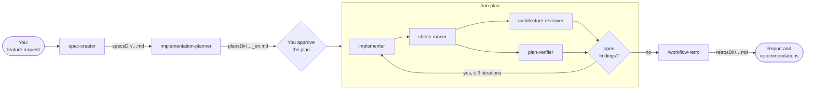

# sdd-engineering

A Spec Driven Development (SDD) workflow for Claude Code: write a spec, plan the change, implement it, check it, review it and verify it against the plan, then learn from the run. Five agents and three skills, with guard hooks that keep each agent inside its role.

```
/plugin install sdd-engineering@dev-digest-toolkit
```

## 1. What it does

A feature goes through a fixed chain. Each step is done by a dedicated agent with its own model, tools and write permissions, and hands the next step a file, not a conversation:

1. **`spec-creator`** turns a request (and design screenshots) into a spec with EARS acceptance criteria. It asks you about every gap before it writes.
2. **`implementation-planner`** reviews the spec against the code, asks its questions, and writes an Implementation Plan: affected modules, contracts, skills to apply, steps, acceptance checks.
3. You approve the plan.
4. **`/run-plan`** executes it: `implementer` → `check-runner` → `architecture-reviewer` ∥ `plan-verifier`, then a fix loop of at most 3 iterations until no major finding is open and the verifier says COMPLETE.
5. **`/workflow-retro`** analyses the finished session: tokens per agent, duplicated reads, tool errors, AC coverage, and concrete recommendations.



`researcher` (from `research-tools`) is standalone: you can call it any time, and `spec-creator` fans out several researchers in parallel when it needs facts it cannot read from the files.

Why split it up: the spec says **what**, the plan says **how**, the implementer **does**, the reviewers **check**. An agent that only writes specs cannot drift into code, a planner that cannot edit files cannot "just fix it", and the verifier audits against the plan item by item instead of giving generic advice.

## 2. Install

```
/plugin marketplace add MShcherbyna/dev-digest-toolkit-marketplace
/plugin install sdd-engineering@dev-digest-toolkit
```

The three dependencies install automatically: [`engineering-paved-path`](../engineering-paved-path/README.md) (stack and architecture skills), [`research-tools`](../research-tools/README.md) (`researcher`) and [`architecture-review`](../architecture-review/README.md) (`architecture-reviewer`).

Optional but recommended: add `.claude/sdd-engineering.json` to your project ([§5](#5-configuration)) so the agents know your modules and check commands, and add your `runsDir` (default `.claude/sdd-runs/`) to `.gitignore`.

## 3. Quick start

A feature end to end, in a project with `.claude/sdd-engineering.json`:

**1. Spec.** In a session:

```
Use the sdd-engineering:spec-creator agent to write a spec for: users can export
their reading list as CSV from the profile page. Screenshot of the profile page attached.
```

When `spec-creator` runs as a subagent it cannot ask you directly: it returns its questions as a batch. Answer them and ask Claude to re-invoke it with the answers. Result: `specs/2026-10-20-reading-list-export.md` (or the module's own `specs/` folder for a single-module feature), `Status: draft`.

**2. Plan.**

```
Use the sdd-engineering:implementation-planner agent to plan
specs/2026-10-20-reading-list-export.md.
```

Round 1 returns a requirements review and asks whether to run **multi-agent** (cross-module work, contracts, UI + API) or **single-agent** (a small one-module change). Answer, and it writes `docs/plans/reading-list-export_en.md` in round 2.

**3. Approve.** Read the plan. Edit it or ask for changes; nothing runs until you decide.

**4. Run.** In a **fresh** chat (the orchestrator needs the context budget):

```
/sdd-engineering:run-plan docs/plans/reading-list-export_en.md
```

Options: `mode:single|multi` overrides the plan's execution mode, `max-fix:N` caps the fix loop (0-5, default 3). Progress is tracked in a ledger, `.claude/sdd-runs/reading-list-export.md`. Nothing is committed: you review the diff and commit.

**5. Retro.** At the end of the same session, or later with the session id:

```
/sdd-engineering:workflow-retro
```

The report goes to `docs/retros/retro-2026-10-20-reading-list-export.md` and is printed in the chat.

## 4. Components

### Agents

| Agent | Responsibility | Model / effort / maxTurns | Tools | Writes | Denied |
|---|---|---|---|---|---|
| `spec-creator` | Feature specs: EARS AC, edge cases, NFRs, provenance, untrusted inputs, open questions; design-gap analysis; asks before writing | opus / high / 30 | Read, Grep, Glob, Write, Edit, AskUserQuestion, Agent (`research-tools:researcher` only), Skill | `<specsDir>/YYYY-MM-DD-<feature>.md`, `<module.specsDir>/…` | Bash, NotebookEdit |
| `implementation-planner` | Requirements review, questions, execution-mode question, then a 12-section Implementation Plan. Never writes specs or code | opus / high / 45 | Read, Grep, Glob, Write, Skill | `<plansDir>/<feature>_en.md` | Agent, Edit, Bash |
| `implementer` | Executes an approved plan, applies its skills, typecheck + targeted tests, records insights | sonnet / medium / 60 | Read, Grep, Glob, Edit, Write, Bash, Skill | project files except `protectedPaths` | Agent; `git commit`/`push`, `forbiddenCommands` |
| `check-runner` | Runs the configured `checks` of the touched modules once; pass/fail table | haiku / low / 15 | Read, Grep, Glob, Bash (read-only git + `checks`) | nothing | Write, Edit, NotebookEdit, Agent |
| `plan-verifier` | Audits code against every plan, spec and user requirement item: PASS / FAIL / PARTIAL / NOT VERIFIABLE / BLOCKED with evidence. Modes: full, plan-vs-spec, narrow | sonnet / medium / 40 | Read, Grep, Glob, Bash (read-only git + `checks`) | nothing | Write, Edit, NotebookEdit, Agent |

Skills preloaded into the agents (from `engineering-paved-path` unless noted):

| Agent | Skills |
|---|---|
| `spec-creator` | engineering-insights, mermaid-diagram, security, `sdd-engineering:design` |
| `implementation-planner` | engineering-insights, onion-architecture, react-frontend-architecture, fastify-best-practices, drizzle-orm-patterns, postgresql-table-design |
| `implementer` | engineering-insights, typescript-expert, zod, plus every skill in plan section 5 |

Each agent also has the `Skill` tool and an instruction to load a listed skill itself if it was not preloaded, so it works either way.

### Skills

| Skill | Invocation | What it does |
|---|---|---|
| `run-plan` | `/sdd-engineering:run-plan <plan> [mode:single\|multi] [max-fix:N]` (manual only) | Orchestrates implement → checks → review ∥ verify → fix loop; keeps a ledger in `runsDir`; builds one review bundle per iteration (`scripts/review-bundle.mjs`) so the reviewers do not each re-run `git diff` |
| `workflow-retro` | `/sdd-engineering:workflow-retro [session-id]` (manual only) | Deterministic session stats (`scripts/session_stats.py`) plus a judgement pass over the transcripts; writes a report to `retrosDir` |
| `design` | auto (UI work) | Chat screenshots are the source of truth, then `designDir`; never invent visuals |

### Hooks

`hooks/hooks.json` wires two guards (see [§6](#6-guards)).

## 5. Configuration

All project-specific knowledge lives in one optional file in your project: **`.claude/sdd-engineering.json`**. The agents, skills and guards read it; nothing about your project is hard-coded in the plugin. Paths you pass in a prompt override it.

| Key | Default | Used by |
|---|---|---|
| `specsDir` | `specs` | spec-creator (cross-module specs), write-guard |
| `plansDir` | `docs/plans` | implementation-planner, plan-verifier, write-guard |
| `runsDir` | `.claude/sdd-runs` | run-plan ledger and review bundles (git-ignore it) |
| `retrosDir` | `docs/retros` | workflow-retro reports |
| `designDir` | `design` | design skill, spec-creator, implementation-planner |
| `architectureDoc` | none | implementation-planner; passed to architecture-reviewer by run-plan |
| `modules[]` | none: the repository root is one module | every agent. Per module: `name`, `path`, `insights` (insights file), `specsDir` (single-module specs), `checks` (commands) |
| `protectedPaths` | `**/package-lock.json`, `**/pnpm-lock.yaml`, `**/yarn.lock`, `**/bun.lock` | implementer, write-guard. Globs: `*`, `**` |
| `forbiddenCommands` | none | implementer, write-guard. Substrings, e.g. `db:migrate` |
| `reviewBundleExcludes` | lockfiles | run-plan review bundle (git pathspec globs) |

Without `checks`, `check-runner` reports `not configured` instead of guessing commands, and `plan-verifier` can only run read-only git. Configure them.

Monorepo example (also in [`templates/sdd-engineering.json`](templates/sdd-engineering.json)):

```json
{
  "specsDir": "specs",
  "plansDir": "docs/plans",
  "runsDir": ".claude/sdd-runs",
  "retrosDir": "docs/retros",
  "designDir": "design",
  "architectureDoc": null,
  "modules": [
    {
      "name": "api",
      "path": "apps/api",
      "insights": "apps/api/INSIGHTS.md",
      "specsDir": "apps/api/specs",
      "checks": ["npm --prefix apps/api run typecheck", "npm --prefix apps/api test"]
    },
    {
      "name": "web",
      "path": "apps/web",
      "insights": "apps/web/INSIGHTS.md",
      "specsDir": "apps/web/specs",
      "checks": ["npm --prefix apps/web run typecheck", "npm --prefix apps/web run lint", "npm --prefix apps/web test"]
    }
  ],
  "protectedPaths": ["**/package-lock.json", "**/pnpm-lock.yaml", "**/migrations/**", "**/vendor/**"],
  "forbiddenCommands": ["db:migrate"],
  "reviewBundleExcludes": ["docs/plans", "**/package-lock.json", "**/pnpm-lock.yaml"]
}
```

Each `checks` entry must be one plain command (no `;`, `&&`, pipes, redirects or `$`): the read-only guard allows exactly these strings, optionally followed by test-file paths for a targeted run.

## 6. Guards

Plugin agents ignore the `hooks` field in their frontmatter, so the guards are plugin hooks in `hooks/hooks.json`. They fire on every Write, Edit and Bash call in the session, read `agent_type` from the hook input, and **exit immediately for anything that is not one of this plugin's agents**: your own session and other agents are never affected. For a guarded agent they fail closed (an unparsable hook input or a broken config blocks the call).

| Agent | Tool | Allowed | Script |
|---|---|---|---|
| `spec-creator` | Write / Edit | `<specsDir>/YYYY-MM-DD-<kebab>.md`, `<module.specsDir>/YYYY-MM-DD-<kebab>.md` | `scripts/write-guard.mjs` |
| `spec-creator` | Bash | nothing | `scripts/write-guard.mjs` |
| `implementation-planner` | Write | `<plansDir>/<kebab>_en.md` | `scripts/write-guard.mjs` |
| `implementer` | Write / Edit | any project file except `protectedPaths`; nothing outside the project | `scripts/write-guard.mjs` |
| `implementer` | Bash | anything except `git commit`, `git push`, `forbiddenCommands`, shell writes to `protectedPaths` | `scripts/write-guard.mjs` |
| `plan-verifier`, `check-runner` | Bash | one plain command: read-only `git diff\|status\|log\|show\|merge-base\|rev-parse\|ls-files\|blame`, or a configured `checks` entry (+ test paths) | `scripts/readonly-bash-guard.mjs --mode verify` |

**Diagnosing a block.** A blocked call returns the guard's message to the agent, prefixed with `sdd-engineering write-guard (<agent>)` or `readonly-bash-guard(verify)`, and the agent reports it. Typical causes:

- *"may only write specs/YYYY-MM-DD-…"*: the file name is not dated kebab-case, or the folder is not `specsDir` / a module's `specsDir`. Fix the name or add the module to the config.
- *"is not on the read-only allowlist"*: the command differs from the configured `checks` string. Copy the exact command into `checks`.
- *"cannot parse .claude/sdd-engineering.json"*: the config is invalid JSON; every guarded call is blocked until it is fixed.

To test a guard by hand, pipe a hook input into it:

```bash
echo '{"agent_type":"sdd-engineering:spec-creator","tool_name":"Write","tool_input":{"file_path":"src/x.md"}}' \
  | CLAUDE_PROJECT_DIR="$PWD" node <plugin-root>/scripts/write-guard.mjs; echo "exit=$?"
```

Exit `2` means blocked (the message is on stderr), `0` means allowed.

## 7. What it runs and where data goes

- **Commands:** `node` for the guards and the review bundle, `git` (read-only in the reviewers; the implementer may use git but not commit or push), the `checks` you configure, whatever commands the plan's steps need inside the implementer, and `python3` for `workflow-retro` (the skill stops with a message if Python 3 is missing).
- **Files written:** specs, plans, the run ledger and review bundles in `runsDir`, retro reports in `retrosDir`, insights entries (implementer, and workflow-retro only after you agree), and the code changes the plan asks for. Nothing is committed or pushed.
- **Files read:** your repository, `.claude/sdd-engineering.json`, and for `workflow-retro` the session transcripts under `~/.claude/projects/<project>/`.
- **Network:** none from this plugin. The `researcher` agent from `research-tools` may use WebSearch / WebFetch when a spec needs external facts.

## 8. Dependencies and compatibility

| sdd-engineering | engineering-paved-path | research-tools | architecture-review |
|---|---|---|---|
| 1.0.x | ^1.0.0 | ^1.0.0 | ^1.0.0 |

Dependencies install with the plugin and resolve to the highest tagged version in the range. Removing or renaming a skill or agent in a dependency is a major release there and requires a matching major release of `sdd-engineering`, because the agents call them by name.

### Evals

`evals/` holds a [`claude plugin eval`](https://code.claude.com/docs/en/plugin-evals) suite that loads all four plugins together:

| Case | Checks |
|---|---|
| `skill-namespace-design` | `sdd-engineering:design` triggers on natural phrasing |
| `skill-namespace-dependency` | `engineering-paved-path:zod` is reachable through the dependency |
| `agent-namespace-researcher`, `…-architecture-reviewer`, `…-plan-verifier` | agents dispatch by their namespaced names |
| `preload-implementer` | diagnostic: cross-plugin skills listed in `skills:` reach the agent |
| `guard-spec-creator` | the write-guard blocks `spec-creator` outside the spec folders |

Run them by hand before a release (they call the model and cost tokens):

```bash
claude plugin eval plugins/sdd-engineering --ablation none --allow-tools Write
```

`--ablation none` skips the no-plugin baseline: without the plugin the agent cases always fail with `Agent type … not found`.

## 9. Origin

Ported from the Spec Driven Development setup of [DevDigest](https://github.com/MShcherbyna/dev-digest) (a fork of [ai-agentic-engineering-neo/dev-digest](https://github.com/ai-agentic-engineering-neo/dev-digest), MIT). Changes in the port:

- Project paths, packages and check commands replaced by `.claude/sdd-engineering.json`.
- Guards moved from agent frontmatter to plugin hooks and rewritten in Node (no Python dependency for the guards).
- Skills and agents referenced by namespaced names (`engineering-paved-path:zod`, `research-tools:researcher`).
- `check-runner` added to the plugin as the fifth agent; the plan is English-only; documentation updates are reported as a to-do instead of being written by a separate agent.

## License

MIT
